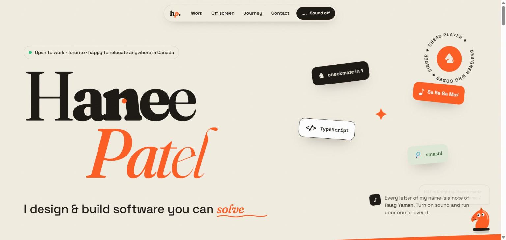

# ✦ hanee2907.github.io – my portfolio

**🌐 Live: https://hanee2907.github.io/**

My personal portfolio, designed and built from scratch. The idea: a portfolio you can *play with*,
just like the projects in it.



## ✨ What makes it different

- **A name you can play:** every letter of "Hanee Patel" is a note of Raag Yaman. Letters swell
  (variable font weight) as the cursor comes near, and with sound on they sing Ṇi Re Ga Ma♯ Pa…
- **Knightly the mascot:** a little chess knight in the corner whose eyes follow your cursor, who
  blinks, says something new in each section, and sings a note when you poke it
- **Stacking project cards:** each project has its own colour world and a live canvas animation
  (a tilted chessboard with a best-move arrow, singing sound rings, orbiting planets, a Raft cluster
  electing a new leader)
- **Off screen, playable:** a mate-in-one chess puzzle with confetti, a carrom striker to flick, the
  aaroh of Raag Yaman, and animated badminton, cricket and volleyball tiles
- **Editorial details:** a statement that lights up word by word as you scroll, a tilted marquee,
  floating stickers with mouse parallax, magnetic buttons, a custom cursor and paper grain

## 🎨 Design

| | |
|---|---|
| Typefaces | [Fraunces](https://fonts.google.com/specimen/Fraunces) (variable: weight, softness and "wonk" axes) and [Space Grotesk](https://fonts.google.com/specimen/Space+Grotesk) |
| Palette | Warm paper `#f3ede2`, ink `#17130e`, electric saffron `#ff5a1f` |
| Motion | One easing curve everywhere (`cubic-bezier(0.16, 1, 0.3, 1)`), and all motion turns off with *prefers-reduced-motion* |
| Accessibility | Semantic sections, skip link, keyboard focus styles, ARIA labels on canvases and the puzzle, sound off by default |

## 🛠️ Built with

- TypeScript (strict mode) and Vite, no UI framework
- CSS3: variable fonts, sticky stacking, `offset-path` animations, `color-mix`, responsive grid
- Canvas 2D for the project illustrations (they only animate while on screen)
- Web Audio API for the plucked-string synth with a little meend (slide) into each note
- IntersectionObserver for reveals and Knightly's lines

## 🚀 Run it locally

```bash
npm install
npm run dev
```

Build with `npm run build` and publish with `npm run deploy`.

## 📁 Structure

```
src/
├── main.ts      # Wires everything up
├── hero.ts      # Playable name and rotating words
├── sound.ts     # Raag Yaman notes and the plucked synth
├── mascot.ts    # Knightly and confetti
├── arts.ts      # Live canvas illustrations for each project
├── puzzle.ts    # Mate-in-one chess puzzle
├── scroll.ts    # Reveals, word-by-word statement, stacking cards, timeline
├── cursor.ts    # Custom cursor, magnetic buttons, sticker parallax
└── style.css    # The whole design system
```

Chess pieces in the puzzle: *cburnett* set by Colin M.L. Burnett (CC BY-SA 3.0).
